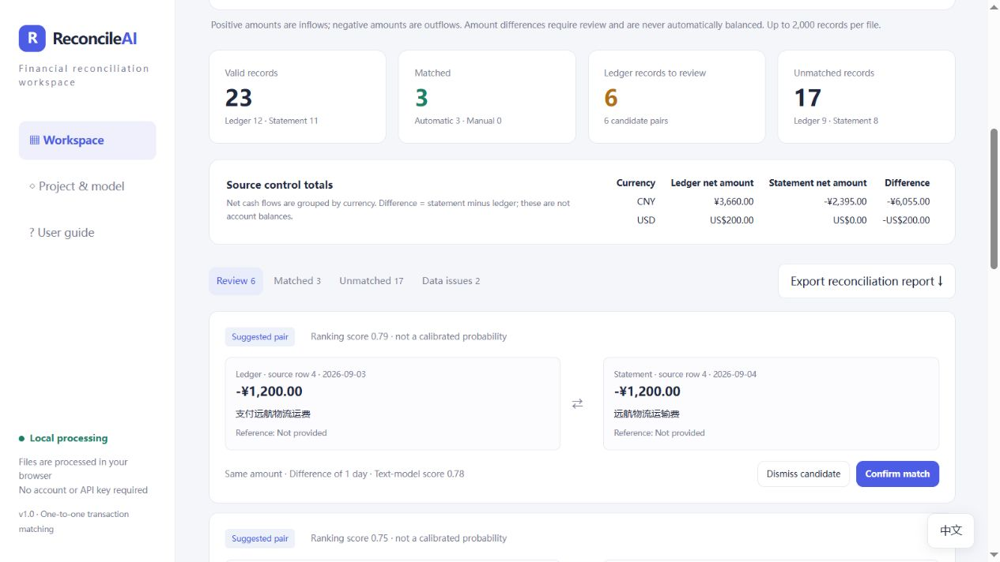

# ReconcileAI

A free, local-first financial reconciliation prototype combining strict rules, a small NLP model and human review.



## Start without coding

Open `dist/index.html`, or use the included Windows launcher. The interface defaults to English. The language button in the bottom-right corner switches to Chinese without resetting your review.

Try **Try sample data**, or import a ledger and a bank statement. English templates are included in `dist/examples/Company-Ledger-Template.xlsx` and `dist/examples/Bank-Statement-Template.xlsx`.

The English templates contain five synthetic transactions each: four automatic pairs, one review candidate and no invalid or duplicate records. Keep the header row when replacing the examples. Inflows are positive and outflows are negative.

## Features

- Import XLSX or CSV, select worksheets and map columns.
- Signed amounts or separate inflow/outflow columns.
- Unique rule matches using currency, amount, dates and references.
- Local text-model ranking for fuzzy pairs, with human confirmation.
- Duplicate warnings, amount discrepancies, reference conflicts and unmatched records.
- Reversible matching, source control totals by currency and CSV export.
- English and Chinese UI. Report labels follow the selected language; original descriptions and reference values are preserved.

All processing occurs in the browser, with no remote AI API or persistence. Refreshing clears the session. Export before leaving.

## Model and limitations

The baseline uses character TF-IDF and text-pair features with logistic regression. It is trained on 68 synthetic labelled pairs and evaluated on 16 separate synthetic pairs. Accuracy is 56.25%, precision 0.545, recall 0.750 and F1 0.632. Similar payees and non-overlapping descriptions remain failure cases. Scores are not calibrated probabilities, and fuzzy pairs are never automatically confirmed.

One-to-one, same-currency transactions only. No FX conversion, one-to-many matching, balance adjustment or journal-entry posting. See the complete [Chinese documentation](README.zh-CN.md) and [evaluation](docs/evaluation.json).

## Development

Node.js 18 or newer; no package installation required.

```
npm test
npm run evaluate
npm run serve
```

Local app: `http://127.0.0.1:8766`. Browser workbook-import checks: `http://127.0.0.1:8766/__qa`.

This is an AI-assisted learning prototype. Describe personal contributions accurately. No real-company deployment or efficiency gains have been established.

MIT License; bundled JSZip retains its own license.

